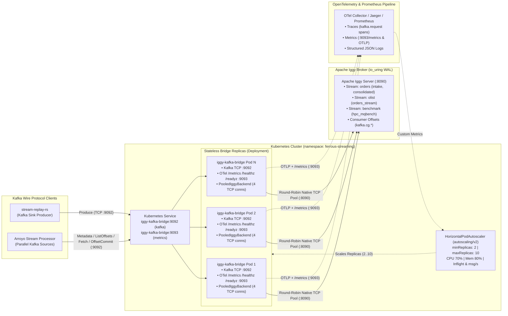

# iggy-kafka-bridge

[← Back to FerrousCX Root Architecture](https://github.com/reidlai/ferrous-cx)

[](https://github.com/reidlai/ferrous-cx)
[](LICENSE)
[](#quickstart)
[](#horizontal-auto-scaling-in-kubernetes-k8s)
[](#opentelemetry-observability-logging-metrics-traces)

**`iggy-kafka-bridge`** is a **100% stateless, horizontally scalable pure-Rust Kafka wire protocol bridge** to **Apache Iggy** for the **FerrousCX** enterprise streaming platform (AD-27, AD-28, FR-33, FR-34, SM-9).

It translates Kafka wire protocol frames (`Produce`, `Fetch`, `ListOffsets`, `Metadata`, `OffsetCommit`, `OffsetFetch`, `FindCoordinator`, `ApiVersions`) on port `9092` directly into native Apache Iggy TCP SDK operations on port `8090` over a lock-free round-robin connection pool, allowing Kafka-native engines (**Arroyo** stateful stream processor and **`stream-replay-rs`** traffic replayer) to read and write Apache Iggy topics without deploying a JVM/C++ Kafka cluster.

---

## 🎯 Objectives

1. **Zero-State Protocol Translation Between Apache Iggy and Arroyo:**
   - Expose a standards-compliant Kafka wire protocol endpoint (`9092`) backed 1:1 by Apache Iggy streams, topics, partitions, and offsets (`0..N`).
   - Delegate 100% of message persistence and consumer group offset storage (`store_consumer_offset` / `get_consumer_offset`) to Apache Iggy and Arroyo checkpoints so bridge pods hold **zero local delivery state**.
2. **Eliminate Single-Node Bottlenecks via Multi-Replica Horizontal Auto-Scaling:**
   - Multiplex concurrent partition `Produce` and `Fetch` requests inside each replica across a configurable **Apache Iggy TCP connection pool** (`--pool-size` / `IGGY_CONNECTION_POOL_SIZE`, default `4`).
   - Support dynamic Kubernetes pod identity (`POD_NAME`, `POD_IP`, `BRIDGE_NODE_ID`) and scale seamlessly from `2` to `10+` replicas via Kubernetes `autoscaling/v2` `HorizontalPodAutoscaler` (`k8s/hpa.yaml`) based on CPU, memory, and live Kafka request load (`bridge_inflight_requests`, `bridge_records_per_second`).
3. **Contract-Driven Topic & Permission Allowlisting (`topics.yml`):**
   - Enforce the platform topic registry (`ferrous-cx/contracts/topics.yml`): only registered `kafka_name` topics resolve (`orders.intake`, `orders.consolidated`, `olist.orders_stream`, `benchmark.hpc_mqbench`), and `Produce` is permitted strictly on topics where `kafka.produce: true`. Unknown or unauthorized topics fail immediately with `UNKNOWN_TOPIC_OR_PARTITION (3)`.
4. **Full OpenTelemetry Observability (Logging, Metrics, Distributed Traces):**
   - Emit structured logs (`BRIDGE_LOG_FORMAT=json|pretty`), per-API-key latency histograms and counters (`GET /metrics` on port `9093` + OTLP), and instrumented `kafka.request` distributed trace spans across all 3 runtime tiers (`OTEL_SDK_DISABLED=true`, `console`, and `otlp`).

---

## 🏛️ Technical Architecture



### Kafka Wire Protocol to Apache Iggy Mapping

| Kafka API Key | Supported Versions | Bridge Translation & Stateless Behavior |
| :--- | :--- | :--- |
| **`ApiVersions` (18)** | `v0–v3` | Advertises supported version ranges for `Produce`, `Fetch`, `ListOffsets`, `Metadata`, `OffsetCommit`, `OffsetFetch`, `FindCoordinator`, and `ApiVersions`. |
| **`Metadata` (3)** | `v0–v9` | Resolves topics from `topics.yml` only; returns `UNKNOWN_TOPIC_OR_PARTITION (3)` for unlisted topics (never auto-creates topics). Advertises the replica's `node_id` and `advertised_host:advertised_port`. |
| **`FindCoordinator` (10)** | `v0–v4` | Returns the current stateless bridge replica endpoint (`node_id`, `advertised_host`, `advertised_port`) because any replica can read/write offsets in Apache Iggy. |
| **`ListOffsets` (2)** | `v1–v7` | Queries `get_partition_offsets` on Apache Iggy via the connection pool: `EARLIEST (-2)` returns `0`; `LATEST (-1)` returns `current_offset` (high watermark). |
| **`Produce` (0)** | `v3–v9` | Verifies `kafka.produce: true` in `topics.yml`, decodes Kafka `RecordBatch` frames, preserves record keys (`kafka.key`) and headers, and appends via `send_messages` to the target Iggy partition. |
| **`Fetch` (1)** | `v4–v11` | Polls messages from Apache Iggy starting at `fetch_offset` (`poll_messages`), encodes them into Kafka v2 `RecordBatch` frames, and returns `OFFSET_OUT_OF_RANGE (1)` if `fetch_offset > high_watermark`. |
| **`OffsetCommit` (8)** | `v2–v9` | Persists committed offsets directly to Apache Iggy under consumer group `kafka.cg.<group_id>` via `store_consumer_offset`. |
| **`OffsetFetch` (9)** | `v1–v9` | Reads committed offsets from Apache Iggy for `kafka.cg.<group_id>` via `get_consumer_offset` (returns `-1` when no offset has been committed yet). |

---

## ☸️ Horizontal Auto-Scaling in Kubernetes (`k8s/`)

To prevent `iggy-kafka-bridge` from becoming a bottleneck between Apache Iggy and Arroyo under high-throughput ingestion:

1. **100% Stateless Pod Topology:**
   - Every bridge pod is stateless. No sticky sessions, Raft/ZooKeeper coordination, or persistent volumes are required on bridge pods.
   - Any replica in the `Deployment` can serve any `Produce`, `Fetch`, or `OffsetCommit` call.
2. **Per-Replica Apache Iggy TCP Connection Pool (`--pool-size`):**
   - Each pod opens `IGGY_CONNECTION_POOL_SIZE` (default `4`) authenticated TCP connections to `iggy-broker:8090` and dispatches requests round-robin using lock-free atomic indexing (`AtomicUsize`), eliminating single-socket head-of-line blocking across partitions.
3. **Dynamic Pod Identity Resolution (`resolve_replica_identity`):**
   - Injects `POD_NAME` and `POD_IP` via the Kubernetes Downward API (`fieldRef`).
   - Automatically derives a deterministic positive Kafka broker `node_id` from StatefulSet ordinals (`iggy-kafka-bridge-2` → `2`) or Deployment pod hashes (`iggy-kafka-bridge-7d8f9c6b4-k8x9q` → FNV-1a hash) and advertises the cluster service or pod IP.
4. **Kubernetes Manifests (`k8s/`):**
   - [`k8s/deployment.yaml`](k8s/deployment.yaml): Hardened non-root (`10001:10001`, `readOnlyRootFilesystem: true`, `capabilities.drop: ["ALL"]`) multi-replica deployment with `/healthz` liveness and `/readyz` readiness probes on port `9093` and topology spread constraints across nodes.
   - [`k8s/service.yaml`](k8s/service.yaml): `ClusterIP` service exposing `9092/TCP` (`kafka`) and `9093/TCP` (`metrics`) with Prometheus scrape annotations.
   - [`k8s/hpa.yaml`](k8s/hpa.yaml): `autoscaling/v2` `HorizontalPodAutoscaler` scaling from `minReplicas: 2` to `maxReplicas: 10` on:
     - **CPU Utilization:** `70%` average utilization
     - **Memory Utilization:** `80%` average utilization
     - **In-Flight Requests (`bridge_inflight_requests`):** target average `32` concurrent requests per pod
     - **Record Throughput (`bridge_records_per_second`):** target average `5000` records/sec per pod

---

## 🔭 OpenTelemetry Observability (Logging, Metrics, Traces)

`iggy-kafka-bridge` implements all three OpenTelemetry observability signals (`src/telemetry.rs`) and adheres to the FerrousCX 3-tier runtime contract (NFR-15):

### 1. Three Operational Runtime Tiers
- **Tier 1 — Disabled / Zero-Overhead (`OTEL_SDK_DISABLED=true`):** No background OTLP network threads are spawned; logs stream cleanly to stdout.
- **Tier 2 — Console Verification (`OTEL_TRACES_EXPORTER=console`):** Outputs structured span and request telemetry directly to container logs for local debugging.
- **Tier 3 — OTLP Collector / Jaeger / Prometheus (`OTEL_EXPORTER_OTLP_ENDPOINT=http://otel-collector:4317`):** Exports distributed traces, metrics, and logs to your cluster's OpenTelemetry Collector while serving Prometheus metrics on `:9093/metrics`.

### 2. Distributed Tracing (`kafka.request` Spans)
Every Kafka wire frame is instrumented with a `tracing::info_span!("kafka.request")` carrying:
- `otel.name` / `kafka.api_key` (`Produce`, `Fetch`, `ListOffsets`, `Metadata`, `OffsetCommit`, `OffsetFetch`, `FindCoordinator`, `ApiVersions`)
- `kafka.api_version`
- `kafka.correlation_id`
- `bridge.node_id`

### 3. Prometheus & OpenTelemetry Metrics (`GET :9093/metrics`)

| Metric Name | Type | Labels | Description |
| :--- | :--- | :--- | :--- |
| `bridge_ready` | `gauge` | `node_id` | Readiness state of the bridge replica (`1` = ready, `0` = not ready) |
| `bridge_iggy_pool_size` | `gauge` | `node_id` | Number of active Apache Iggy TCP connections in the replica's pool |
| `bridge_inflight_requests` | `gauge` | `node_id` | Current number of in-flight Kafka wire requests (HPA scaling signal) |
| `bridge_requests_total` | `counter` | `node_id`, `api_key` | Total Kafka wire requests processed per API key |
| `bridge_request_errors_total` | `counter` | `node_id` | Total malformed frame or backend dispatch errors |
| `bridge_records_produced_total` | `counter` | `node_id` | Total Kafka records produced into Apache Iggy |
| `bridge_records_fetched_total` | `counter` | `node_id` | Total Kafka records fetched from Apache Iggy |
| `bridge_records_per_second` | `gauge` | `node_id` | Sustained record throughput rate across produce and fetch paths (HPA signal) |
| `bridge_otel_spans_recorded_total` | `counter` | `node_id` | Total OpenTelemetry `kafka.request` trace spans recorded |
| `bridge_request_duration_us` | `histogram` | `node_id`, `le` | Request latency distribution in microseconds (`100`, `500`, `1000`, `5000`, `10000`, `50000`, `+Inf`) |

### 4. Structured Logging (`BRIDGE_LOG_FORMAT`)
- Set `BRIDGE_LOG_FORMAT=json` (default in Kubernetes) for structured JSON logs with thread and span correlation, or `BRIDGE_LOG_FORMAT=pretty` (default locally) for human-readable console output.
- Control log verbosity via `RUST_LOG` (default: `iggy_kafka_bridge=info,info`).

---

## 🚀 Quickstart

### 1. Local Build & Test (Cargo)

```bash
# Run all unit, wire-protocol, multi-replica scaling, OpenTelemetry, and Kubernetes manifest tests
cargo test

# Run strict linter check
cargo clippy --all-targets -- -D warnings

# Run the bridge locally against a running Apache Iggy broker (localhost:8090)
cargo run -- \
  --config ../ferrous-cx/contracts/topics.yml \
  --iggy-address 127.0.0.1:8090 \
  --iggy-username iggy \
  --iggy-password iggy \
  --pool-size 4 \
  --listen-bridge 0.0.0.0:9092 \
  --advertised-bridge-host 127.0.0.1 \
  --metrics-listen 0.0.0.0:9093
```

### 2. Verify Health, Readiness & Prometheus Metrics

```bash
# Liveness probe
curl http://127.0.0.1:9093/healthz
# -> {"node_id":1,"service":"iggy-kafka-bridge","status":"healthy"}

# Readiness probe
curl http://127.0.0.1:9093/readyz
# -> {"iggy_pool_size":4,"node_id":1,"ready":true,"service":"iggy-kafka-bridge","status":"ready"}

# Prometheus metrics exposition
curl http://127.0.0.1:9093/metrics
```

### 3. Deploy to Kubernetes with Horizontal Auto-Scaling

```bash
# 1. Create namespace and secret for the bridge Iggy credentials
kubectl create namespace ferrous-streaming --dry-run=client -o yaml | kubectl apply -f -
kubectl -n ferrous-streaming create secret generic iggy-kafka-bridge-secret \
  --from-literal=BRIDGE_IGGY_PASSWORD='your-secure-bridge-password'

# 2. Create ConfigMap from the platform topics.yml contract
kubectl -n ferrous-streaming create configmap ferrous-topics-contract \
  --from-file=topics.yml=../ferrous-cx/contracts/topics.yml

# 3. Apply Deployment, Service, and HorizontalPodAutoscaler (autoscaling/v2)
kubectl apply -f k8s/deployment.yaml
kubectl apply -f k8s/service.yaml
kubectl apply -f k8s/hpa.yaml

# 4. Monitor replicas and HPA scaling status
kubectl -n ferrous-streaming get pods -l app.kubernetes.io/name=iggy-kafka-bridge
kubectl -n ferrous-streaming get hpa iggy-kafka-bridge-hpa
```

---

## ⚙️ CLI Flags & Environment Variables Reference

| CLI Flag | Environment Variable | Default Value | Description |
| :--- | :--- | :--- | :--- |
| `-c`, `--config` | `IGGY_KAFKA_TOPICS_PATH` | `topics.yml` | Path to the `topics.yml` topic registry and allowlist contract |
| `--iggy-address` | `IGGY_SERVER_ADDRESS` | `127.0.0.1:8090` | Apache Iggy native TCP broker address |
| `--iggy-username` | `IGGY_USERNAME` | `bridge` | Apache Iggy username for the bridge service account |
| `--iggy-password` | `IGGY_KAFKA_IGGY_PASSWORD` | `bridge` | Apache Iggy password for the bridge service account |
| `--pool-size` | `IGGY_CONNECTION_POOL_SIZE` | `4` | Number of pooled Apache Iggy TCP connections per replica |
| `--listen-bridge` | `BRIDGE_BIND_COMPOSE` | `0.0.0.0:9092` | Bind address for the primary Kafka wire protocol listener |
| `--advertised-bridge-host` | `BRIDGE_ADVERTISED_COMPOSE_HOST` | `bridge` | Advertised Kafka broker hostname (falls back to `POD_IP` when default) |
| `--advertised-bridge-port` | `BRIDGE_ADVERTISED_COMPOSE_PORT` | `9092` | Advertised Kafka broker port |
| `--listen-host` | `BRIDGE_BIND_HOST` | *None* | Optional second Kafka listener bind address for host loopback |
| `--advertised-host-host` | `BRIDGE_ADVERTISED_HOST_HOST` | `127.0.0.1` | Advertised hostname for the optional second listener |
| `--advertised-host-port` | `BRIDGE_ADVERTISED_HOST_PORT` | `9092` | Advertised port for the optional second listener |
| `--node-id` | `BRIDGE_NODE_ID` | *Auto from `POD_NAME` or `1`* | Explicit Kafka broker node ID |
| `--pod-name` | `POD_NAME` | *None* | Kubernetes pod name (used to derive deterministic `node_id`) |
| `--pod-ip` | `POD_IP` | *None* | Kubernetes pod IP address |
| `--metrics-listen` | `BRIDGE_METRICS_ADDR` | `0.0.0.0:9093` | Bind address for HTTP `/metrics`, `/healthz`, and `/readyz` server |
| `--healthcheck` | — | `false` | Run one-shot Iggy connectivity healthcheck and exit (`0` or `1`) |
| — | `OTEL_SDK_DISABLED` | `false` | Disable OpenTelemetry SDK (`true` activates Tier 1 zero-overhead mode) |
| — | `OTEL_SERVICE_NAME` | `iggy-kafka-bridge` | OpenTelemetry service name attribute |
| — | `OTEL_EXPORTER_OTLP_ENDPOINT` | *None* | OTLP collector endpoint (e.g., `http://otel-collector:4317`) |
| — | `OTEL_TRACES_EXPORTER` | `otlp` | Traces exporter (`otlp`, `console`, `none`) |
| — | `OTEL_METRICS_EXPORTER` | `otlp` | Metrics exporter (`otlp`, `console`, `none`) |
| — | `OTEL_LOGS_EXPORTER` | `otlp` | Logs exporter (`otlp`, `console`, `none`) |
| — | `BRIDGE_LOG_FORMAT` | `pretty` | Log format (`pretty` or `json`) |

---

## 📄 License

Licensed under the [MIT License](LICENSE).
